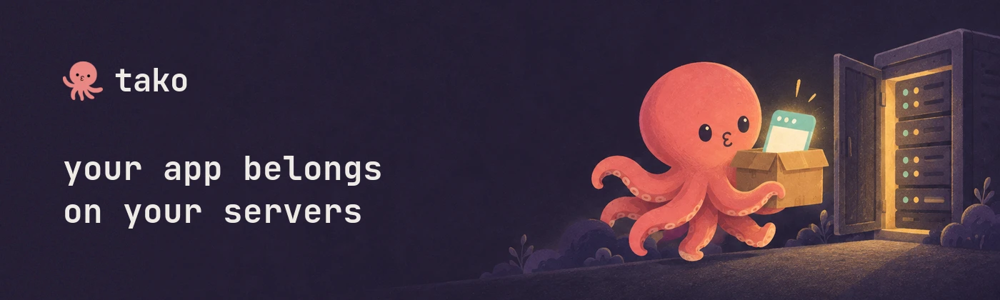

<a href="https://tako.sh" target="_blank" rel="noopener"></a>

[](https://www.npmjs.com/package/tako.sh)
[](https://crates.io/crates/tako)
[](https://skills.sh/tako-sh/tako)

## What is Tako?

Tako is a complete, opinionated application platform for solo builders, running on your own VPS.

Local development, rolling deploys, HTTPS, logs, secrets, workflows, channels, storage, and more work together in one platform designed to stay manageable by one person.

Keep control of your infrastructure, data, and costs, with access to a full runtime: Node.js, Bun, Go, or an application packaged with a Dockerfile.

Tako chooses a simple workflow and thoughtful defaults so you can build and run your application without assembling a platform yourself. Start on one VPS; run the same app on multiple servers when needed.

## Install

Install the CLI:

```bash
curl -fsSL https://tako.sh/install.sh | sh
```

Verify:

```bash
tako --version
```

Start local development from your app directory:

```bash
bun add tako.sh   # or: npm install tako.sh
tako dev
# optional temporary public URL:
tako dev --tunnel
```

Set up a deployment host:

```bash
# Connect the host and your workstation to Tailscale or NetBird first.
# If needed, servers add offers to install the service over SSH.
sudo sh -c "$(curl -fsSL https://tako.sh/install-server.sh)"
tako servers add my-server
# Install/repair without the interactive confirmation:
tako servers add my-server --install
# Use a non-root administrator when root SSH access is disabled:
tako servers add ubuntu@my-server
# Custom public ports:
tako servers add my-server --http-port 8080 --https-port 8443
```

Deploy your app:

```bash
tako init    # prompts for app name + route, offers wildcard HTTPS setup, writes tako.toml
tako servers add my-server
# Optional: Let’s Encrypt wildcard certificates via Cloudflare DNS-01; traffic can stay DNS-only/direct.
# Use a user or account API token with Zone Read and DNS Write for the matching Cloudflare zone.
tako credentials set ssl.cloudflare --env production --expires-on "in 90 days"
# Optional: Cloudflare Origin CA certificates for Cloudflare-proxied apps.
# Set ssl = "cloudflare" in tako.toml, then store a token with Zone / SSL and Certificates / Edit:
tako credentials set ssl.cloudflare --env production --expires-on "in 90 days"
tako deploy
```

## Quick links

- [Quickstart](https://tako.sh/docs/quickstart) — install to live in minutes
- [How Tako Works](https://tako.sh/docs/how-tako-works) — architecture and mental model
- [Channels](https://tako.sh/docs/channels) — durable SSE and WebSocket streams
- [Presence](https://tako.sh/docs/presence) — authenticated live membership and React hooks
- [Stores](https://tako.sh/docs/stores) — live backend data with optional cached offline reads
- [Workflows](https://tako.sh/docs/workflows) — durable jobs, retries, schedules, and signals
- [tako.toml Reference](https://tako.sh/docs/tako-toml) — every config option
- [CLI Reference](https://tako.sh/docs/cli) — all commands and flags
- [Framework Guides](https://tako.sh/docs/framework-guides) — adapter examples
- [Local Development](https://tako.sh/docs/development) — HTTPS, DNS, environment variables
- [Deployment](https://tako.sh/docs/deployment) — deploy flow, rolling updates, rollbacks
- [Troubleshooting](https://tako.sh/docs/troubleshooting) — common issues and fixes
- [Examples](https://github.com/tako-sh/tako/tree/master/examples)
- [SDK](https://www.npmjs.com/package/tako.sh)
- [Benchmarks](BENCHMARKS.md) — current TLDR and raw-data links
- [Runtime Protocol](PROTOCOL.md) — contracts shared by the CLI, server, and SDKs

## Agent Skills

Install Tako skills for Codex, Claude Code, Cursor, and other skills.sh-compatible agents:

```bash
npx skills add tako-sh/tako
```

Install a specific skill with `--skill tako`, `--skill tako-sdk-js`, `--skill tako-sdk-go`, or `--skill tako-sdk-rust`.

## License

MIT — see [LICENSE](LICENSE).

## Coding agents

Run `tako agents` to configure your coding agents with Tako workflow skills and
MCP tools for development, logs, diagnostics, and deployment. Interactive
`tako init` offers the same setup. Skills and documentation ship with the CLI;
skills are also installable with `npx skills add tako-sh/tako`.

See the [coding agent guide](https://tako.sh/docs/agents/) for supported clients,
manual MCP setup, and automation options.
